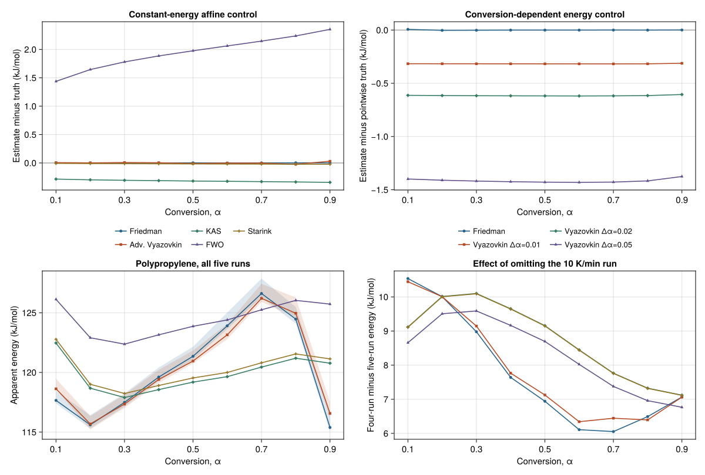

# Known-truth recovery and polypropylene apparent activation energy

## Independent recovery controls

The [protocol](../config/public_tg_energy.toml) declares the conversion grid, control
energies, program rates, recovery tolerances, and numerical settings. A standalone
Python RK4 solver integrates the first-order reaction in the variable
`y = −log(1 − α)`, then records time, temperature, and remaining mass on an irregular
clock. It generates four traces at each of three known truths. The highest difference
between four and eight RK4 substeps per output interval was 9.05 × 10⁻¹⁴ in conversion.
An independent SciPy DOP853 solve agreed with the generated conversion values to
1.06 × 10⁻¹¹ across the 12 traces.
Julia imports the resulting CSVs through the ordinary TG entry point with their
known 12 mg initial and 2 mg terminal references. These controls use no pICNIK data or
Julia simulation routines.

| Control | Estimator | Largest absolute error against E(α), kJ/mol |
|---|---|---:|
| Constant 160 kJ/mol, affine | Friedman | 0.00251 |
| Constant 160 kJ/mol, affine | Advanced Vyazovkin, Δα = 0.02 | 0.03014 |
| Constant 160 kJ/mol, affine | KAS | 0.34180 |
| Constant 160 kJ/mol, affine | FWO | 2.35354 |
| Constant 160 kJ/mol, affine | Starink | 0.02427 |
| Constant 160 kJ/mol, curved heating | Friedman | 0.01112 |
| Constant 160 kJ/mol, curved heating | Advanced Vyazovkin, Δα = 0.02 | 0.03411 |
| Variable `E(α) = 125 + 65α` kJ/mol, affine | Friedman | 0.00670 |
| Variable `E(α) = 125 + 65α` kJ/mol, affine | Advanced Vyazovkin, Δα = 0.01 / 0.02 / 0.05 | 0.31774 / 0.61919 / 1.43061 |

All declared recovery checks passed before the experimental fit. On the variable-energy
control, the largest difference between the Δα = 0.02 estimate and the energy at the
interval midpoint was 0.04444 kJ/mol. The method fits one apparent energy over each
increment. Comparing its result with the pointwise truth shows how the interval width
changes its location on the energy profile. The ramp approximations were tested on the
constant-energy affine control, where the temperature-program assumption holds.
[Incremental isoconversional method](https://doi.org/10.1002/1096-987X%2820010130%2922%3A2%3C178%3A%3AAID-JCC5%3E3.0.CO%3B2-%23) · [Linear-heating approximations](https://eprints.soton.ac.uk/18822/)

## Polypropylene estimates

The reference uses plateau-median mass references and the nine central conversion
targets audited previously. Friedman uses the reference quadratic half-window, set
to 3% of each run's recorded time from α = 0.10 to 0.90. Advanced Vyazovkin uses
Δα = 0.02, recorded time and temperature, eight subdivisions per measured step, and
the declared 20–500 kJ/mol search. KAS, FWO, and Starink use the measured full-record
OLS heating rates as constant-ramp comparisons. The same settings apply to both cohorts.
[Prior method checks](public_tg_method_checks.md)

All values are apparent activation energies in kJ/mol.

| α | Friedman, 5 runs | Adv. Vyazovkin, 5 runs | KAS, 5 runs | FWO, 5 runs | Starink, 5 runs | Friedman, omit 10 | Adv. Vyazovkin, omit 10 |
|---:|---:|---:|---:|---:|---:|---:|---:|
| 0.10 | 117.66 | 118.63 | 122.47 | 126.13 | 122.78 | 128.19 | 129.07 |
| 0.20 | 115.61 | 115.68 | 118.68 | 122.90 | 119.01 | 125.62 | 125.69 |
| 0.30 | 117.49 | 117.35 | 117.90 | 122.37 | 118.23 | 126.47 | 126.49 |
| 0.40 | 119.61 | 119.41 | 118.56 | 123.15 | 118.91 | 127.25 | 127.18 |
| 0.50 | 121.35 | 120.95 | 119.19 | 123.87 | 119.54 | 128.29 | 128.08 |
| 0.60 | 123.91 | 123.15 | 119.65 | 124.40 | 120.00 | 130.02 | 129.50 |
| 0.70 | 126.62 | 126.21 | 120.45 | 125.25 | 120.80 | 132.67 | 132.65 |
| 0.80 | 124.47 | 124.96 | 121.19 | 126.04 | 121.55 | 130.96 | 131.35 |
| 0.90 | 115.39 | 116.56 | 120.77 | 125.73 | 121.13 | 122.45 | 123.63 |

Friedman and advanced Vyazovkin agree within 1.18 kJ/mol on both baseline profiles.
Their largest estimate occurs at α = 0.70 in both cohorts and across all seven
conversion scenarios with the primary method settings. Both decrease at α = 0.90.
The three ramp comparisons have flatter profiles across the central grid.

Omitting the run near 10 K/min raises all five methods at every tested target. The
shift is 6.05–10.54 kJ/mol for Friedman and 6.34–10.44 kJ/mol for advanced
Vyazovkin. Across the seven reaction-window and mass-reference scenarios, the largest
change from the corresponding plateau-median primary estimate is 2.92 kJ/mol. Across
the four derivative settings the maximum span is 0.57 kJ/mol. Across the three Δα
choices it is 3.58 kJ/mol. Doubling time subdivisions changes the primary estimates
by at most 2.35 × 10⁻⁶ kJ/mol. Run selection has the largest tested effect on the
energy level. The 10 K/min run has an apparent negative terminal mass. The measured
normalization sensitivity leaves the cause of its influence unresolved. Both cohorts
remain explicit in the results.



The shaded ranges show the seven tested conversion scenarios with primary method
settings. Experimental uncertainty from repeat measurements and transport effects
remains unquantified. The apparent profile characterizes the selected TG observable
and protocols. Reaction identities and the kinetic triplet require additional evidence.

## Reproduction

Run from the repository root with Julia 1.11 and Python 3.11+. The fetch command
downloads the pinned pICNIK source files under `data/external/picnik/raw/`.
The audit generates temporary synthetic controls with the Python standard
library and verifies the polypropylene source bytes against the import manifest.
The independent energy check also uses NumPy and SciPy.

```sh
python -B scripts/fetch_public_benchmarks.py --sources picnik
julia --startup-file=no --project=. -e 'using Pkg; Pkg.instantiate()'
julia --startup-file=no --project=. scripts/audit_public_tg_energy.jl
python -B scripts/verify_public_tg_energy.py
julia --startup-file=no --project=docs scripts/plot_public_tg_energy.jl
```

The [machine-readable audit](audits/public_tg_energy.toml) contains all crossing
temperatures and source brackets, run IDs, diagnostics, settings, recovery errors,
input hashes, and scenario estimates. The [crossing audit](public_tg_conversion_support.md) and [method checks](public_tg_method_checks.md) reproduce the input diagnostics.
The independent check reconstructs the PP estimates from the pinned raw files,
with Gauss–Legendre quadrature and SciPy bounded optimization for the recorded-time
profiles. All 414 estimates agreed within 4.93 × 10⁻⁶ kJ/mol.
