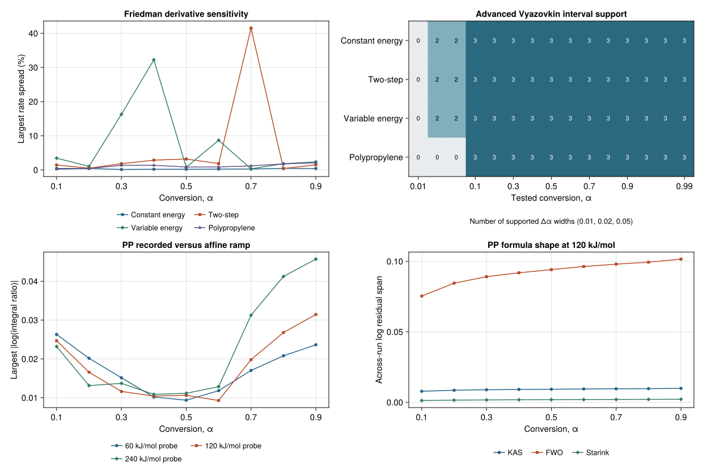

# Method checks before TG activation-energy estimation

The checks use the 18 pinned pICNIK runs in the [crossing and temperature support audit](public_tg_conversion_support.md).
They cover the constant-energy, two-step, and variable-energy simulations and the five
experimental polypropylene (PP) programs. The comparison uses plateau-median mass
references. The scenario audits also use the alternative reaction intervals and mass
references from the [conversion audit](public_tg_conversion.md). All energy values in
the integration checks are fixed numerical probes supplied as inputs.

## What the data support

| Check | Findings on the central grid, α = 0.10 to 0.90 |
|---|---|
| Friedman | Every run has a positive derivative under all four local polynomial settings with plateau-median references. The largest within-run rate ratio across settings is 1.021 for PP, 1.005 for constant energy, 1.42 for two steps, and 1.32 for variable energy. |
| Advanced Vyazovkin | All 486 plateau-median run, target and width combinations have a strict recorded-time branch. Across all seven PP conversion scenarios, Δα = 0.01 and 0.02 retain all nine central targets. The wider Δα = 0.05 loses α = 0.10 in the cropped scenarios because the lower crossing falls before the selected data. |
| KAS, FWO, and Starink | The synthetic temperature histories agree with their endpoint-matched ramps to numerical precision. The largest central PP recorded-versus-affine integral difference is −4.47% at α = 0.90 for the 20 K/min run and the 240 kJ/mol probe. |

**Friedman.** The audit fit recorded conversion against time near each unique upward
crossing, comparing linear and quadratic fits at the reference width and three
quadratic widths. For PP, every central target had positive rates under all tested
settings and all seven conversion scenarios. The plateau-median rate ratio rises to
1.35 at α = 0.99. Several synthetic controls show materially greater rate sensitivity
while retaining positive derivatives. The audit retains rate contrasts between runs
alongside each run's sensitivity because the contrasts affect the Friedman slope.
[Friedman audit](public_tg_friedman.md)

**Advanced Vyazovkin.** Of 5,085 requested intervals, 4,388 have strict branch
support. The remaining intervals include out-of-interior targets, nonunique or absent
crossings, and internal reversals or plateaus. The interval keeps every recorded row
between the two interpolated boundaries. Across the supported windows at the fixed
probes, measured-node and legacy uniform-conversion trapezoids differ from the finest
tested time refinement by at most 0.082% and 0.398%, respectively. The difference
between the 8- and 16-subdivision refinements stays below 0.001%. Some supported
variable-energy windows contain just one interior measurement, so numerical refinement
and experimental sampling remain separate checks. [Recorded-time audit](public_tg_vyazovkin.md)

**Linear-ramp approximations.** At α = 0.10 a 300 °C start removes up to 80.5% of the
recorded PP integral at the 60 kJ/mol probe. A late start can therefore improve the
affine match while changing the integral substantially. At α = 0.50 and the 120 kJ/mol
probe, the across-run log-shape residual spans are 0.00931 for KAS, 0.09411 for FWO,
and 0.00190 for Starink. The across-run log span of recorded-versus-affine path
differences is 0.01433 at the same point. These quantify the two effects separately.
They depend on the probe and the temperature range. [Ramp and approximation audit](public_tg_ramp_approximations.md)

Omitting the PP run near 10 K/min preserves the central positive-rate and strict
interval grids and the largest baseline derivative and ramp sensitivities. Carry both
sets forward when comparing estimates. The subsequent audit validates recovery on
known-truth controls and compares estimates on the PP common grid.
[Known-truth recovery and PP energy estimates](public_tg_energy.md)



The figure uses plateau-median references. It shows the largest within-run rate ratio
as `100 × (maximum/minimum − 1)`, the count of strictly supported widths at each target, the largest
PP measured-to-affine log ratio magnitude, and formula shape residuals at the 120 kJ/mol
probe. Each statistic is computed across the runs in its own material group.

## Reproduction

Run the checks from the repository root with the pinned TG data available.

```sh
julia --startup-file=no --project=. scripts/audit_public_tg_friedman.jl
julia --startup-file=no --project=. scripts/audit_public_tg_vyazovkin.jl
julia --startup-file=no --project=. scripts/audit_public_tg_ramp_approximations.jl
julia --startup-file=no --project=docs scripts/plot_public_tg_method_checks.jl
```

The three audit reports regenerated byte for byte. Independent calculations checked
all derivative classifications, recorded-time paths, and affine ramp and formula-shape
integrals. A separate Gauss–Legendre integration of the raw paths agreed with all
13,164 refined Vyazovkin probe integrals within 3.22 × 10⁻⁶ in log integral and with all
270 central PP ramp probes within 7.11 × 10⁻¹⁵.
